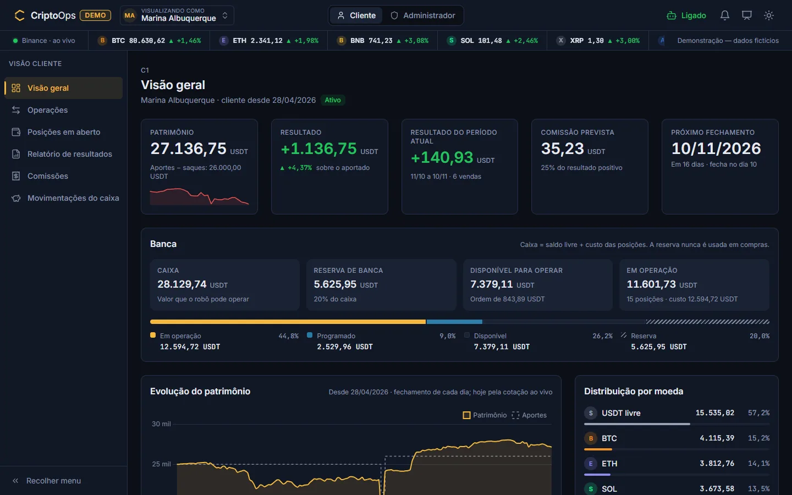
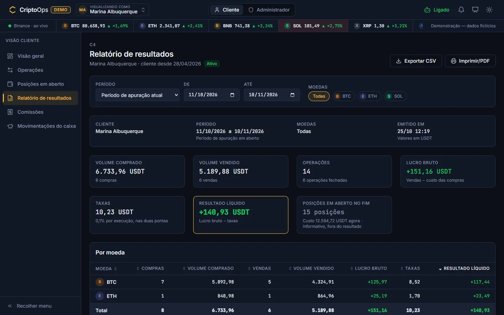
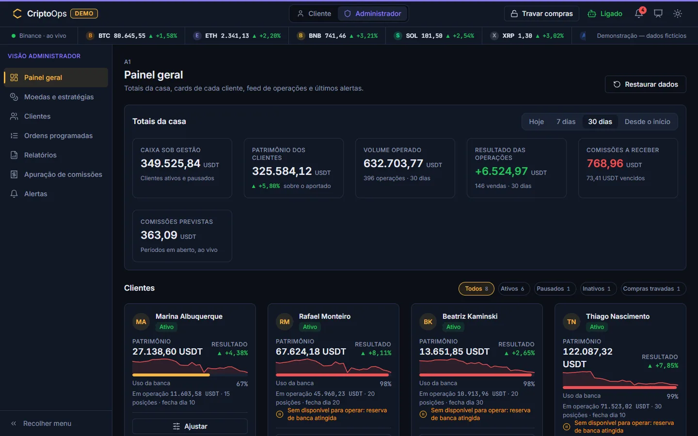
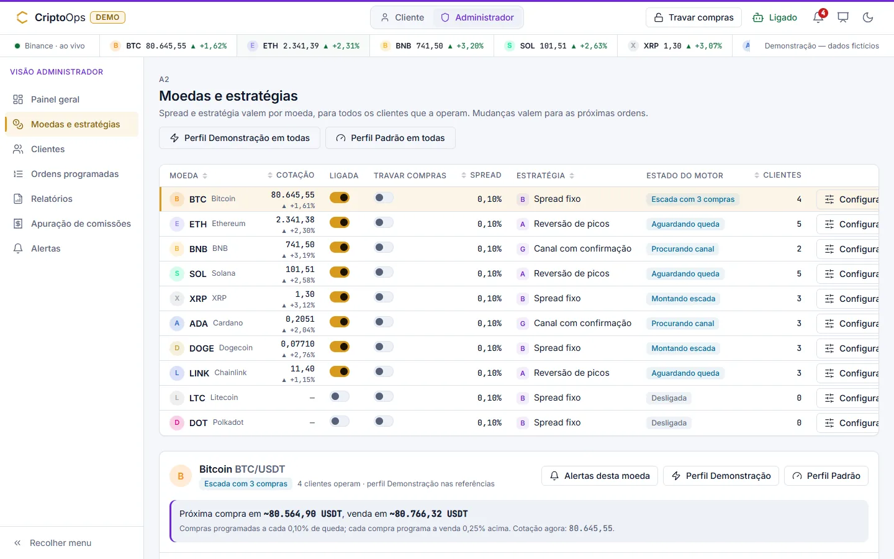
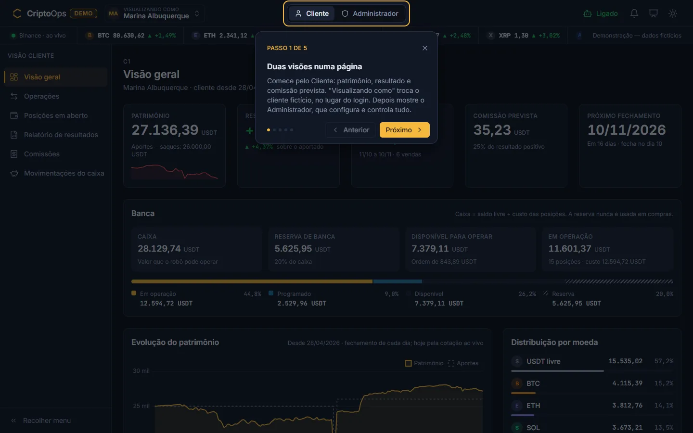
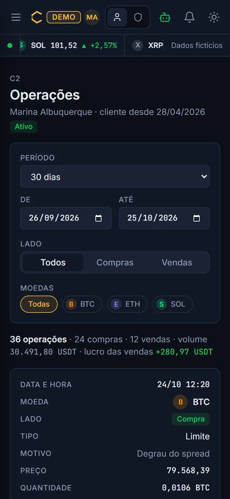

# CriptoOps — Painel de Operações Cripto (MVP)

Demonstração de um sistema de gestão de operações de criptomoedas feitas por um robô para vários clientes. O **cliente** acompanha compras, vendas, posições em aberto, resultado e comissão. O **administrador** configura moedas, estratégias, caixa e reserva de banca dos clientes e alertas; trava compras, cancela ordens programadas, apura as comissões e emite os relatórios.

> **Demonstração.** As cotações são reais (API pública da Binance). Clientes, saldos, operações e comissões são fictícios e gerados no navegador. Não há login, banco de dados nem envio de ordens à corretora.

**Ver ao vivo:** [maksoud.dev/criptomoedas](https://maksoud.dev/criptomoedas/)



<table>
  <tr>
    <td width="50%"></td>
    <td width="50%"></td>
  </tr>
  <tr>
    <td></td>
    <td></td>
  </tr>
</table>

<p align="center"></p>

## Como funciona

- **Uma página, duas visões.** Um botão no topo alterna entre **Cliente** e **Administrador**. Na visão Cliente, a lista "Visualizando como" escolhe de qual cliente fictício são os dados (no lugar do login).
- **Cotações reais ao vivo.** Os preços chegam da Binance a cada segundo. Se a conexão falhar, o sistema passa para cotações simuladas e avisa no topo.
- **Robô simulado.** Um motor aplica as estratégias configuradas sobre os preços reais, e as novas compras e vendas aparecem nos relatórios sem recarregar a página. Para a apresentação ter movimento, o perfil "Demonstração" usa spreads menores; o perfil "Padrão" usa os valores realistas.
- **Histórico inicial.** Ao abrir, o sistema baixa 180 dias de preços da Binance e gera sobre eles o histórico de 8 clientes e 10 moedas, sempre igual no mesmo dia. O botão "Restaurar dados" volta a esse ponto.

### Visão do cliente

| Tela | O que mostra |
|---|---|
| Visão geral | Patrimônio, caixa, reserva de banca, disponível, em operação, resultado, comissão prevista e próximo fechamento |
| Operações | Compras e vendas executadas, com filtro por período, moedas e lado |
| Posições em aberto | Compras aguardando venda, com cotação atual e distância até o alvo |
| Relatório de resultados | Lucro bruto, taxas e resultado líquido por período e moedas; exporta CSV e PDF |
| Comissões | Período em aberto (ao vivo) e períodos apurados e pagos |
| Movimentações do caixa | Depósitos e saques |

### Visão do administrador

| Tela | O que permite |
|---|---|
| Painel geral | Totais da casa, cards de cada cliente, feed de operações e últimos alertas |
| Moedas e estratégias | Ligar/desligar moedas, definir o spread, escolher a estratégia e ajustar todos os parâmetros, inclusive lucro mínimo e confirmação de sinal |
| Clientes | Caixa, reserva de banca, valor por ordem, comissão, dia de fechamento, moedas operadas e status |
| Ordens programadas | Ver e cancelar compras e vendas aguardando execução; definir novo alvo |
| Relatórios | Relatório de um cliente ou consolidado de todos |
| Apuração de comissões | Fechar períodos, marcar como pago, ver o total a receber |
| Alertas | Regras, limites, canais de aviso e ações automáticas |
| Travar compras | Bloqueia novas compras (geral, por cliente ou por moeda); vendas continuam |

### Estratégias do robô

- **Reversão de picos** — compra quando o preço sobe 3% a partir do menor valor recente e vende quando cai 3% a partir do maior valor desde a compra, só se o lucro mínimo estiver garantido.
- **Spread fixo** — mantém compras programadas a cada queda de X% e, a cada compra executada, programa a venda com Y% de lucro.
- **Canal com confirmação** — identifica suporte e resistência, só opera depois que o canal é confirmado, compra perto do fundo, vende perto do topo e sai no rompimento.
- **Sugestões** — escalonada por níveis (preço médio), grade em faixa, compra periódica (DCA) e cruzamento de médias móveis.

Todas aceitam **confirmação de sinal** (N velas, tempo ou volume) antes de agir. Detalhes e alertas em [docs/ESTRATEGIAS.md](docs/ESTRATEGIAS.md).

### Regras de cálculo

- **USDT é a moeda base.** O robô opera várias moedas, mas toda compra sai de USDT e toda venda volta para USDT. Caixa, resultados, comissões e relatórios são sempre em USDT.
- **Caixa** é o valor que o robô pode operar para o cliente; a **reserva de banca** (% do caixa) nunca é usada em compras.
- **Spread** e estratégia são definidos por moeda; caixa, reserva e valor por ordem, por cliente.
- **Lucro de uma venda** = valor da venda − custo da compra de origem − taxas (0,1% por execução).
- **Comissão por período de apuração**: o cliente escolhe fechar no dia 10, 20 ou 30 do mês. No fechamento, o resultado das operações fechadas no período é congelado e a comissão (% sobre o resultado positivo) é contabilizada. Prejuízo não passa para o período seguinte.
- **Pagamento e continuidade**: a comissão vence em até 5 dias após o fechamento. Se não for paga, as novas compras do cliente ficam suspensas até o pagamento; as vendas programadas continuam até o administrador decidir cancelá-las.

## Tecnologia

HTML, CSS e JavaScript puro (ES Modules), sem etapa de build. API pública da Binance (REST e WebSocket, sem chave) para cotações. Chart.js para gráficos, Lucide para ícones, Inter e JetBrains Mono como fontes. Preferências, ajustes do admin (moedas, clientes, alertas, travas) e cache de preços ficam no `localStorage` do navegador; depósitos, pagamentos, cancelamentos e o log valem até o fim do dia (o histórico fictício muda a cada dia). "Restaurar dados", no Painel geral do admin, apaga tudo isso.

## Como apresentar (5 minutos)

O botão **Como apresentar** (ícone de tela no topo, ou no rodapé) abre um tour de 5 passos com este roteiro. Também dá para abrir direto com `?tour` no endereço: `https://maksoud.dev/criptomoedas/?tour`.

1. **Duas visões** (1 min): na visão Cliente, mostre patrimônio, resultado e comissão prevista; troque o cliente em "Visualizando como".
2. **Cotações ao vivo** (30 s): a faixa do topo atualiza a cada segundo; o ponto verde indica Binance ao vivo.
3. **Relatório** (1 min): Relatório de resultados → mude o período, filtre moedas, exporte CSV ou imprima em PDF.
4. **Travar compras** (1 min 30 s): passe para Administrador, clique em "Travar compras" e mostre a faixa de aviso; destrave. Em Ordens programadas, cancele uma ordem e mostre o efeito na visão do cliente.
5. **Alertas** (1 min): abra o sino; em Alertas (A7) use "Testar alerta" numa regra.

Nada exige recarregar a página. Para voltar ao estado inicial depois da apresentação, use **Restaurar dados** no Painel geral do admin.

### Antes de apresentar: testar a rede

Algumas redes corporativas bloqueiam a Binance. Abra a demo na rede da apresentação e confira o ponto à esquerda da faixa de cotações:

- **"Binance · ao vivo"** (verde): tudo certo.
- **"Cotações simuladas"** (com aviso no topo): a Binance está bloqueada ou caiu. A demo funciona igual, com preços simulados a partir de valores de referência (ou dos últimos preços reais, se a conexão caiu no meio). Vale avisar o público.

Para ensaiar a queda sem mexer na rede, rode no console do navegador `criptoops.feed.simularQueda(30)`: em ~3 s entram as cotações simuladas e, depois de 30 s, a Binance volta sozinha.

## Acessibilidade e celular

- Navegação completa por teclado, com foco visível, atalho "Pular para o conteúdo" e linhas de tabela clicáveis que abrem com Enter.
- Alta e baixa nunca só pela cor: sempre com sinal (+/−) e seta (▲/▼).
- Contraste AA nos dois temas; avisos e números dos cartões anunciados a leitores de tela (`aria-live="polite"`).
- Respeita `prefers-reduced-motion` (sem flashes, rolagens suaves nem faixa de cotações andando).
- No celular, as tabelas viram cartões empilhados e só um aviso aparece por vez.

## Rodar localmente

Os módulos JavaScript precisam ser servidos por HTTP (abrir o arquivo direto com `file://` não funciona):

```bash
# na pasta criptomoedas/
npx serve .
# ou
python -m http.server 8080
```

No servidor do maksoud.dev a pasta precisa do `.htaccess` com `DirectoryIndex index.html index.php`.

## Documentação

| Arquivo | Conteúdo |
|---|---|
| [docs/PLANO_MVP.md](docs/PLANO_MVP.md) | Escopo, arquitetura, uso da Binance, regras de negócio, fases e decisões |
| [docs/ESTRATEGIAS.md](docs/ESTRATEGIAS.md) | Estratégias, parâmetros, confirmação de sinal e alertas |
| [docs/DADOS_FICTICIOS.md](docs/DADOS_FICTICIOS.md) | Modelo de dados em memória e gerador do histórico |
| [docs/IDENTIDADE_VISUAL.md](docs/IDENTIDADE_VISUAL.md) | Cores, tipografia, componentes e tom de voz |
| [docs/fases/](docs/fases/) | Uma lista de tarefas e critérios de aceite por fase (F0 a F6) |
| [docs/testes.html](docs/testes.html) | Asserções do gerador, relatórios, períodos, filtros, CSV, comissões, conexão ao vivo, velas, estratégias, confirmação de sinal, motor, alertas, apuração automática e ações do admin (abrir pelo servidor local, com a aba visível) |
| [docs/CRYPTOBOT_MVP.md](docs/CRYPTOBOT_MVP.md) | Análise de um projeto anterior — só para consulta de lógica, não define regras deste |

## Andamento

| Fase | Entrega | Status |
|---|---|---|
| F0 | Fundação: topo, troca de visão, rotas, tema | Concluída |
| F1 | Histórico de preços, dados fictícios e store | Concluída |
| F2 | Cotações ao vivo (Binance) | Concluída |
| F3 | Visão do cliente | Concluída |
| F4 | Motor de estratégias e alertas | Concluída |
| F5 | Visão do administrador | Concluída |
| F6 | Polimento e publicação | Concluída |
